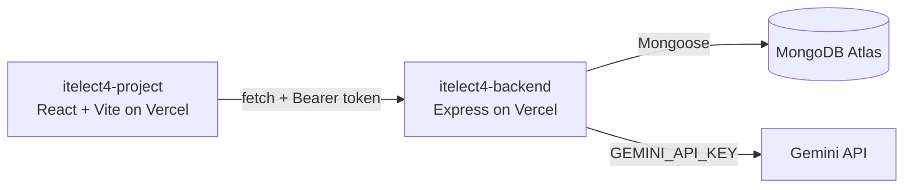

# ITELECT4 RSVP Tracker

[](https://github.com/zirishbelo/itelect4-project/actions/workflows/ci.yml)

React and Vite frontend for the ITELECT4 RSVP Tracker. Students and attendees can browse events, sign in, and manage their own RSVP statuses.

- **Live app:** https://itelect4-project-neon.vercel.app
- **Live API:** https://itelect4-backend-ivory.vercel.app/api/health
- **Backend repository:** https://github.com/zirishbelo/itelect4-backend

## Architecture



## Local development

```bash
npm install
copy .env.example .env
# Set VITE_API_URL=http://localhost:4000 in .env
npm run dev
```

Useful checks:

```bash
npm test
npm run build
```

## AI-use disclosure

The application includes an authenticated AI Review feature backed by Gemini.